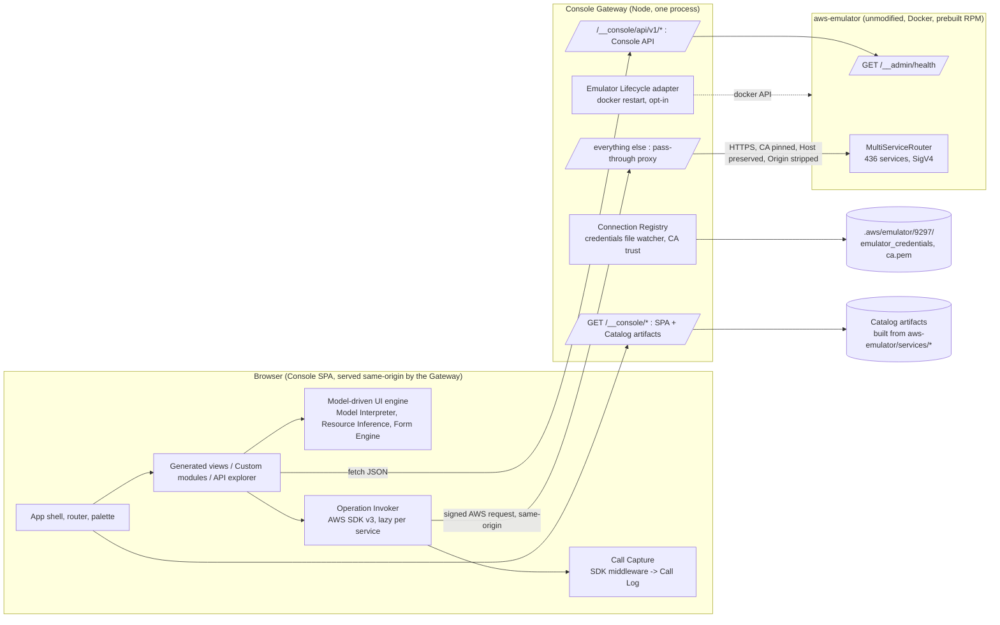

# AWS Emulator Console: Architecture

Status: accepted design, 2026-11-18. Nothing here is built yet. Decisions marked **(ADR-NNNN)** are recorded in `docs/adr/`; every user decision is logged in `DECISIONS.md`; the build order is in `IMPLEMENTATION-PLAN.md`.

Scope (ADR-0010): the Console serves **this** emulator only, unmodified, as shipped in the prebuilt Docker image. It is not a generic client for other AWS-compatible emulators.

Vocabulary follows `GLOSSARY.md`. Terms in **bold** on first use are defined there.

---

## 1. What the evidence forces

The product spec ("UI Design Spec.md" and the 8 decoded prototype screens) was written for a generic, LocalStack-style endpoint: `http://localhost:4566`, `test`/`test` credentials, browser calls straight to the endpoint with CORS. This emulator is different, and these differences shape the whole design:

| Fact | Evidence | Consequence |
|---|---|---|
| The emulator refuses every cross-site browser request, and the allowlist is hard-coded to same-origin only. | `vendor/smithy-server-runtime/src/multi_service_router.rs:372-390` (`refuse_cross_site_browsers` uses `RemoteOrigins::SameOriginOnly`, `allow_remote = false`). The data port in `vendor/server/src/lib.rs:1268-1274` adds no CORS layer. | A browser page on any other origin cannot call the emulator, even with CORS. "Route through local proxy" is required, not optional. |
| HTTPS only, self-signed CA, minted per process. | `vendor/server/src/lib.rs:1233-1300`; CA written to `~/.aws/emulator/<port>/ca.pem` (present at `.aws/emulator/9297/ca.pem` via the compose volume). | Browsers would show a certificate error. A process that trusts `ca.pem` must sit in between. |
| SigV4 is on by default; keys are minted fresh on every start. | `cli.rs` usage text (`-a on|off`, default on); `request_authentication.rs:125-130` (`EMULATOR` + 12 hex key id, 40 hex secret); written as an INI profile to `<port>/emulator_credentials` (`request_authentication.rs:603-616`) and removed on shutdown. | `test`/`test` does not work. Credentials must be read from the file and re-read after every restart. |
| Port 9297, not 4566. | `DEFAULT_DATA_PORT`, compose file. | The spec's defaults change. |
| The emulator source must not be edited in the places an admin API would live. | `README.md`: `vendor/` is "replaced on update"; `core/router/src/lib.rs` and the root `Cargo.toml` are "RE-RENDERED on every service add"; `core/router/src/main.rs` says "emitted ONCE ... Do not edit it". README: "We don't accept pull requests". | New `/__admin/*` endpoints inside the emulator have no safe home. (The vendored `WithExtraRoutes` seam exists in `vendor/server/src/lib.rs:1507`, but wiring it needs an edit to `main.rs`.) |
| The Docker image does not build this repo. | `Dockerfile/emulator.Dockerfile` installs `aws-emulator-aarch64.rpm` from `LTS/latest`. README: building from source is Linux-only, needs ~100 GB of `target/`. The host is macOS. | The running emulator may not match `aws-emulator/` source. Any source-derived fact (operation status) is a hint to verify at runtime, never ground truth. |
| State is an opaque in-memory type-map with no enumeration, serialization or clear. | `vendor/engine/src/lib.rs` public API: `new`, `state::<T>()`, `listeners()`. | No generic "state snapshot" is possible. **Reset** means restarting the emulator process. Resource listing must go through service APIs. |
| All 436 service crates are mounted in one router. | `core/router/src/lib.rs` registers every crate. | "Running / Not running" from the spec has no meaning here. The useful signals are **Coverage** (implemented operations) and **Availability** (does the running binary route the service). |
| Only 127 of 436 models declare Smithy `resource` shapes; Kinesis declares none. 3,746 of 19,454 operations are `@paginated`; only 2,687 are `@readonly`. 359 of 436 services have a `List*`/`Describe*` operation with no required input. | Script over `services/*/smithy-model/*.json` (this session). | Smithy resources alone cannot drive generated views. Generated views need heuristic inference plus declarative overrides. |
| AWS SDK for JavaScript v3 publishes a client for every service checked, at version 3.1171.0, and the Kinesis client already has the emulator model's newer operations (`ListChannels`, ...) and more besides (58 commands versus 45 modeled). Clients are now schema-based (`dist-es/schemas/schemas_0.js`) over shared protocol classes in `@aws-sdk/core` (`AwsJson1_0Protocol`, `AwsRestJsonProtocol`, `AwsQueryProtocol`, `AwsEc2QueryProtocol`, `AwsRestXmlProtocol`). | `npm view` and `npm pack` (this session). | The SDK can be the wire layer for all services. Its version must be pinned and checked against the catalog. |
| Model sizes: 123 MB in total, largest 5.2 MB; stripping docs and endpoint rules cuts Kinesis from 444 KB to 278 KB. | Same script. | Load models per service, lazily, after a build-time compile step. Never load all of them into the browser. |

---

## 2. System overview



Three deployable things:

1. **Emulator**: unchanged. Still the `emulator` service in `docker-compose.yaml`.
2. **Console Gateway**: a small Node/TypeScript server. It serves the SPA and the **Catalog** artifacts, exposes the **Console API**, and reverse-proxies AWS requests to the active **Connection**. (ADR-0001, ADR-0002)
3. **Console SPA**: React + TypeScript, built by Vite, served by the gateway. (ADR-0011)

The **Catalog** is a build artifact, compiled from the emulator's own Smithy models and source tree. (ADR-0004)

---

## 3. Component responsibilities and interfaces

Each module below is "deep": a small interface over a lot of behavior. TypeScript signatures are illustrative contracts, not final code.

### 3.1 Catalog Compiler (build time, `packages/catalog-compiler`)

Reads the emulator tree and writes static, versioned JSON. It is the only code that knows the emulator's file layout.

Inputs:
- `aws-emulator/services/service-*/smithy-model/*.json` (several crates have 2 or 3 model files; merge their `shapes`).
- `aws-emulator/services/service-*/src/ops/*.rs` header doc comments: an operation is **Scaffolded** when its header carries the line `//! SCAFFOLDED, NOT IMPLEMENTED:`; match the header line, never a substring anywhere in the file (implemented ops such as `get_shard_iterator.rs` mention the phrase elsewhere).
- `src/ops/SKIPPED_STUBS.md`: `// SKIPPED: <Op>` lines, minus `// HAND-AUTHORED: <Op>` lines, give **Unrouted** operations.
- `aws-emulator/issues/things-that-do-not-work/*.md` (optional): **Known Issues** per service, keyed by crate name in the file name or body.
- `console/catalog/categories.json`: service key to **Category** (22 categories), seeded from the prototype's `SVCS` table (decoded from the design HTML; keyed by `api-models-aws/models/<dir>` names such as `s3`, `route-53`).
- `console/catalog/overrides/*.ts`: per-service **Overrides** (section 5).
- The pinned `@aws-sdk/client-*` packages: for each operation, whether a `<Op>Command` export exists (**SDK Support**).

Outputs (under `dist/catalog/<fingerprint>/`):
- `index.json`: one **Catalog Entry** per service (about 150 KB).
- `services/<serviceId>.ui.json`: the **UI Model** (operations, normalized shapes, pagination, inferred **Resource Types**, docs stripped).
- `services/<serviceId>.docs.json`: documentation strings, loaded only when a form or panel asks.
- `manifest.json`: source commit, emulator version if known, SDK version, fingerprint, counts.

```ts
// index.json
interface CatalogEntry {
  serviceId: string;            // stable console id, e.g. "kinesis" (api-models dir name)
  crate: string;                // "service-com-amazonaws-kinesis-kinesis-20131202"
  title: string;                // "Amazon Kinesis"
  sdkId: string;                // "Kinesis"
  sdkPackage: string;           // "@aws-sdk/client-kinesis"
  signingName: string;          // "kinesis"
  protocol: "restJson1" | "awsJson1_0" | "awsJson1_1" | "awsQuery" | "ec2Query" | "restXml" | "undeclared";
  category: CategoryId;
  tier: "custom" | "generated"; // from catalog/custom-ui.json
  coverage: { implemented: number; scaffolded: number; unrouted: number; total: number; level: "full" | "partial" | "none" };
  probeOp?: OpName;             // cheapest implemented read op with no required input, used for Availability
  rootResourceTypes: string[];  // for Home counts, palette, discovery
  knownIssues: number;
}
```

Command: `pnpm catalog:build`. Check: `pnpm catalog:check` exits non-zero when the emulator tree's fingerprint differs from the committed catalog manifest (a CI guard, section 7).

### 3.2 Model Interpreter (runtime and build time, `packages/model`)

Pure functions that turn one Smithy JSON AST into the UI Model. Used by the compiler; also shipped to the browser for tests and for an "open raw model" escape hatch.

```ts
interface UiModel {
  service: ServiceMeta;
  operations: Record<OpName, OperationModel>;
  shapes: Record<ShapeId, UiShape>;       // normalized: structure, list, map, union, enum, scalar
  resourceTypes: ResourceType[];          // filled by Resource Inference (3.3)
}
interface OperationModel {
  name: OpName;
  kind: "read" | "write";                 // @readonly, else name prefix (List|Describe|Get|Head|Search|Query|Batch-Get), else write
  status: "implemented" | "scaffolded" | "unrouted";
  sdk: "supported" | "missing";
  input?: ShapeId; output?: ShapeId; errors: ShapeId[];
  pagination?: { inputToken: string; outputToken: string; pageSize?: string; items?: string };
  streaming?: "input" | "output" | "event-stream";
  group: string;                          // explorer grouping, e.g. "Messages", "Queues", "Tags"
}
```

### 3.3 Resource Inference (`packages/model`, runs in the compiler)

Turns operations into **Resource Types**. Deterministic rules, then Overrides win.

1. Smithy `resource` shapes, where present (127 services), give identifiers and lifecycle operations directly.
2. Otherwise, a **Root List Operation**: `List<Noun>s` / `Describe<Noun>s` with no required input. Its output's first list member is the item collection.
3. Pair it with a **Describe Operation**: `Describe<Noun>` / `Get<Noun>` / `Describe<Noun>Summary` whose required input is a single member that the list item carries (by name, or `<Noun>Name` / `<Noun>Arn` / `<Noun>Id`).
4. **Child Resource Types**: `List<Child>s` whose only required input is the parent's identifier (Kinesis consumers under streams, DynamoDB items are custom).
5. **Resource Actions**: `Create<Noun>`, `Delete<Noun>`, `Update<Noun>*`, `Put<Noun>*`, and any write operation whose required input includes the identifier.
6. Columns: scalar members of the list item; if the item is only an identifier (Kinesis `ListStreams` returns names plus `StreamSummaries`), enrich lazily from the Describe Operation for visible rows only.
7. Tag operations (`ListTagsForResource`, `TagResource`, `UntagResource`) attach to every Resource Type with an ARN.

Coverage measured this session: rule 2 finds at least one Root List Operation for 359 of 436 services; 1,699 `List*` operations pair with a `Describe*`/`Get*`. The other 77 services (data planes, runtimes, `Get*`-style APIs such as Lightsail, Cognito's `ListUserPools` that requires `MaxResults`) fall back to the API explorer until an Override adds a Resource Type.

```ts
interface ResourceType {
  id: string;                         // "kinesis:stream"
  label: { singular: string; plural: string };
  parent?: { type: string; via: string };    // input member carrying the parent id
  list: { op: OpName; itemsPath: string; idField: string; requiredDefaults?: Record<string, unknown> };
  describe?: { op: OpName; idInput: string; resultPath?: string };
  columns: ColumnSpec[];
  actions: ActionSpec[];              // each refers to an op; Create, Delete, custom ones
  arnField?: string;
  source: "smithy-resource" | "inferred" | "override";
}
```

### 3.4 Operation Invoker (`packages/invoker`), (ADR-0006)

The one seam every view uses to talk to a service.

```ts
interface OperationInvoker {
  invoke<I, O>(call: { connectionId: string; serviceId: string; op: OpName; input: I;
                       signal?: AbortSignal; origin: CallOrigin }): Promise<InvokeResult<O>>;
  paginate<I, O>(call: ..., opts: { maxPages?: number }): AsyncIterable<InvokeResult<O>>;
}
type InvokeResult<O> =
  | { ok: true; output: O; meta: CallMeta }
  | { ok: false; kind: "not-implemented" | "service-error" | "auth" | "network" | "unknown-service" | "sdk-missing";
      code?: string; message: string; meta?: CallMeta };
```

Implementation: AWS SDK for JavaScript v3. A generated file `sdk-registry.gen.ts` maps every `serviceId` to `() => import("@aws-sdk/client-x")`, so Vite emits one lazy chunk per service and nothing is loaded until used. The Invoker builds one client per (connection, service), cached, with:
- `endpoint`: the Gateway's own origin (pass-through, ADR-0003);
- `credentials`: fetched from `GET /__console/api/v1/connections/{id}/credentials`, refreshed when the Gateway's `credentialsEpoch` changes;
- `forcePathStyle: true` for S3; `maxAttempts` and timeout from the Connection;
- the Call Capture middleware (3.5).

It looks up `new mod[`${op}Command`](input)`. If the export is missing (the SDK is older than the emulator model), it returns `sdk-missing` and the explorer offers the raw request built from the model instead.

A 501 with error code `NotImplemented` maps to `kind: "not-implemented"` and reports the operation to the **Observed Status** store (section 6).

Bespoke modules may also import SDK helpers directly (`@aws-sdk/lib-storage` multipart upload, `@aws-sdk/s3-request-presigner`, `@aws-sdk/lib-dynamodb`). They still use clients from `Invoker.clientFor(...)`, so capture and credentials are shared.

### 3.5 Call Capture and Call Log (`packages/invoker` + `features/inspector`)

An SDK middleware, added to every client at the `finalizeRequest` step after signing and at the `deserialize` step, writes one **Call Record** per logical call with its attempts:

```ts
interface CallRecord {
  id: string; startedAt: number; durationMs: number;
  connectionId: string; serviceId: string; op: OpName; origin: CallOrigin; // "user" | "view" | "discovery" | "probe"
  resourceHint?: string;
  request: { method: string; url: string; headers: Record<string,string>; body?: string | { bytes: number } };
  response?: { status: number; headers: Record<string,string>; body?: string; requestId?: string };
  outcome: "ok" | "error" | "not-implemented" | "network";
  attempts: { n: number; status?: number; ms: number }[];
}
```

The Call Log is an in-memory ring buffer (default 5,000 records) with a subscription API. Bodies over 256 KB are truncated. Calls with `origin: "discovery" | "probe"` are hidden by default in the inspector and excluded from the "failed calls" count. Export HAR maps records to HAR 1.2.

### 3.6 Form Engine (`packages/forms`)

```ts
function formFor(model: UiModel, op: OpName, hints?: FieldHints): FormSpec;
function toInput(spec: FormSpec, value: FormValue): { input: unknown; issues: Issue[] };
function fromInput(spec: FormSpec, input: unknown): FormValue;   // "Edit in API explorer", replay, saved runs
```

- Required members first; optional ones folded ("3 more optional fields").
- Field kinds from shapes: string (with `@length`, `@pattern`), number (`@range`), boolean, enum (select), timestamp, blob (text, file or base64), list (repeatable), map (key/value editor), structure (fieldset), union (pick one member), document (JSON editor).
- A JSON tab always exists and round-trips with the form.
- **Suggestions**: a field whose name matches a Resource Type identifier (`QueueUrl`, `StreamName`, `FunctionName`, ARNs) is filled from that type's cached list (the "suggestions from ListQueues" in the design).
- Recursive shapes stop at depth 6 and fall back to JSON for the subtree.

### 3.7 Snippet Generator (`packages/snippets`)

`snippet(kind: "sdk-v3" | "cli" | "http", call, connection) => string`. SDK and CLI forms come from model names (`SendMessageCommand`, `aws sqs send-message --queue-url`; CLI names are the kebab-case of the operation and members). The HTTP form is the captured, signed request from the Call Record when one exists, otherwise a preview without a signature. Snippets use the real endpoint (`https://127.0.0.1:9297`) and point at the credentials file and `AWS_CA_BUNDLE`, not at the Gateway.

### 3.8 Service Module registry (the generated / custom seam), (ADR-0005)

```ts
interface ServiceModule {
  serviceId: string;
  tier: "custom" | "generated";
  routes: RouteDef[];                         // mounted under /services/:serviceId/...
  resourceViews?: Partial<Record<ResourceTypeId, ResourceViewSlots>>;
  paletteProviders?: PaletteProvider[];       // "Create DynamoDB table", resources
  homeCard?: HomeCardProvider;
}
interface ResourceViewSlots {                 // ladder step 3: replace parts of a generated view
  Cell?: Record<ColumnId, Component>;
  DetailPanel?: Component;
  Actions?: Record<ActionId, Component>;
}
```

Every service gets `generatedModule(serviceId)` unless `modules/<serviceId>/index.ts` registers something else. A custom module can mount generated pieces (`<GeneratedResourceTab type="s3:access-point" />`) so it never has to rebuild the long tail of its own service. The API explorer route exists for every service and cannot be removed by a module.

### 3.9 Console Gateway (`apps/gateway`), (ADR-0001, ADR-0002, ADR-0003)

Routing on one origin (default `http://127.0.0.1:9300`):

| Path | Handler |
|---|---|
| `GET /__console/` and assets | SPA (index.html for client routes) |
| `GET /__console/catalog/<fingerprint>/*` | Catalog artifacts, immutable cache headers |
| `/__console/api/v1/*` | Console API (section 4) |
| `GET /__admin/health` | Pass-through to the active connection |
| everything else | Pass-through AWS proxy |

Pass-through proxy rules:
- Accept only same-origin browser requests: `Sec-Fetch-Site` is `same-origin` (or absent with no `Origin`, for curl-style tests) and `Origin`, when present, equals the Gateway's own origin. Everything else gets 403. This reproduces the emulator's own browser rule for the Gateway's origin. (ADR-0003)
- Target = the Connection named by header `x-console-connection` (set by the Invoker), else the active Connection.
- Forward method, path, query, body and `Host` unchanged, so the browser's SigV4 signature still verifies. Strip `Origin`, `Referer`, `Cookie`, `Sec-Fetch-*` (not signed by the SDK).
- TLS to the emulator: trust only the connection's `ca.pem`, verify identity as `127.0.0.1` (the CA names the dialable host, `vendor/server/src/lib.rs:1236-1243`), so the gateway can dial `emulator:9297` inside compose.
- Stream bodies both ways (S3 objects). Do not buffer.
- Rewrite nothing in responses. URLs the emulator returns (queue URLs, presigned URLs) name `https://127.0.0.1:9297`. The SPA turns them into Gateway URLs only when it must fetch them itself (S3 object preview, downloads).

### 3.10 Connection Registry (Gateway)

```ts
interface Connection {
  id: string; name: string; endpoint: string; region: string;   // account is always 000000000000 for this emulator
  caFile?: string; credentials: { source: "emulator-file"; path: string } | { source: "static"; accessKeyId: string; secretRef: string }; // static: phase 3, another instance of this emulator
  serviceEndpointOverrides?: Record<ServiceId, string>;
  behaviour: { s3PathStyle: true; maxAttempts: number; timeoutMs: number };
}
```

The default Connection, "Local emulator", is discovered from `CONSOLE_EMULATOR_HOME` (default: the mounted `.aws/emulator`) and port 9297. The Gateway watches `<port>/emulator_credentials`; on change it increments `credentialsEpoch` and pushes an event (section 4), so the SPA rebuilds its clients after a restart.

Storage split (DECISIONS.md, D-9): Connections live in the Gateway config file (`$CONSOLE_CONFIG_DIR/connections.json`, default `/data` in the container), because the Gateway must know each one to proxy to it. Preferences (pinned services, accent, recently viewed resources, saved explorer runs, Observed Status cache) live in browser `localStorage` under the key prefix `console:v1:`. The MVP ships exactly one Connection, the auto-discovered local one; the Connections screen shows it read-only apart from client behaviour settings.

### 3.11 Emulator Lifecycle adapter (Gateway)

Reset is a restart (ADR-0008). `reset(connectionId)`: for the compose-managed connection, restart the `emulator` container (name from `CONSOLE_EMULATOR_CONTAINER`, default `emulator`) through the Docker Engine API, then poll `/__admin/health` until 200 and wait for a new credentials file (timeout 60 s). Enabled only when the Docker socket is mounted **and** `CONSOLE_ENABLE_RESET=1`. Otherwise the API answers `409 reset-unavailable` with the manual command (`docker compose restart emulator`), and the Home "Reset emulator state" button opens a dialog with that command to copy. Either way, after the credentials epoch changes the SPA shows a banner: "Emulator restarted. Credentials rotated; apps that cached the old keys must reload them." The confirm dialog for Reset states the same before it runs.

---

## 4. Console API contract (Gateway, `/__console/api/v1`)

JSON over same-origin HTTP. Every error is `{ "error": { "code": string, "message": string } }`. Versioned by path. It names emulator concepts, not Gateway internals, so its shape does not depend on where it is served (ADR-0002).

| Method and path | Response | Notes |
|---|---|---|
| `GET /meta` | `{ gatewayVersion, catalog: { fingerprint, sourceCommit, sdkVersion, builtAt }, features: { reset: boolean } }` | The SPA loads `catalog/<fingerprint>/index.json` from here. |
| `GET /connections` | `{ active: id, items: ConnectionSummary[] }` | `ConnectionSummary` has no secrets. |
| `POST /connections`, `PUT /connections/{id}`, `DELETE /connections/{id}`, `POST /connections/{id}/activate` | the `ConnectionSummary` | Phase 3. Until then the API answers `405` and the list holds only the local connection. |
| `GET /connections/{id}/credentials` | `{ accessKeyId, secretAccessKey, sessionToken?, epoch }` | Same-origin only, `Cache-Control: no-store`. |
| `GET /connections/{id}/health` | `{ reachable, status, latencyMs, checkedAt, credentialsEpoch, tls: "ok"|"untrusted"|"error" }` | Wraps `/__admin/health`; drives the toolbar pill. |
| `POST /connections/{id}/checks` | `{ checks: { id, ok, detail }[] }` | Connections screen: reachable, TLS trusted, credentials accepted (`sts:GetCallerIdentity`), S3 path-style (`ListBuckets`). The design's "CORS allowed" check is replaced by "Gateway same-origin". |
| `POST /connections/{id}/probe` | `{ results: { serviceId, availability: "available"|"absent"|"unknown", via: OpName, status, checkedAt }[] }` | Availability probes for many services at once (section 6.1); concurrency 8; results cached per credentials epoch. |
| `POST /connections/{id}/reset` | `202 { jobId }` or `409 reset-unavailable { command }` | Restart; see 3.11. |
| `GET /events` (SSE) | `health`, `credentials-rotated`, `reset-progress` events | One stream per tab. |
| `GET /emulator-url?u=<url>` | streamed bytes | Fetch a URL the emulator handed out (presigned S3 GET), only when its origin is the connection's endpoint. |

Contract tests live in `apps/gateway/test/contract/*` and run against a recorded fake and against the real emulator (section 7).

---

## 5. The model-driven UI engine and the customization ladder (ADR-0005, ADR-0007)

Every service starts fully generated. Making a service nicer means climbing the ladder only as far as needed. Each step is cheaper to maintain than the next.

| Step | What you write | Where | Example |
|---|---|---|---|
| 0. Inferred | nothing | Resource Inference | Kinesis streams list, describe and actions |
| 1. Overrides (data) | labels, column picks and order, hidden ops, identifier fixes, extra Resource Types, required list defaults, action grouping, op groups for the explorer | `console/catalog/overrides/<serviceId>.ts` (typed, validated by the compiler) | Cognito: `ListUserPools` with `MaxResults: 60`; Lightsail: `GetInstances` as a Root List Operation |
| 2. Field hints | per-member widgets and suggestion sources | same file, `fields:` | SQS `MessageBody` as JSON-aware text; `QueueUrl` suggests from `sqs:queue` |
| 3. Slots | React components for a cell, detail panel or action inside a generated view | `apps/web/src/modules/<serviceId>/slots.tsx` | Lambda: "Invoke" action panel with log tail |
| 4. Custom module | whole routes | `apps/web/src/modules/<serviceId>/` | S3 object browser, DynamoDB item editor |

Rules that keep the seam clean:
- Overrides are data, so the compiler can validate them against the model. An override that names an operation the model lacks fails `catalog:build`.
- Custom modules never call `fetch` directly. They use the Invoker, so the inspector, credentials and Observed Status work everywhere.
- A custom module covers what it designs and mounts generated tabs for the rest of its service.
- The API explorer is the floor: every operation of every service is always reachable there.

Generated view data flow (Kinesis example):

```
route /services/kinesis/streams
  -> catalog.load("kinesis")                       (index.json, kinesis.ui.json; cached)
  -> resourceType "kinesis:stream"                 (inferred: ListStreams + DescribeStreamSummary)
  -> useInfiniteQuery(["kinesis","ListStreams",conn])  -> Invoker.paginate(NextToken)
  -> rows visible -> useQueries(DescribeStreamSummary per row, concurrency 4) to fill columns
  -> select row -> DescribeStreamSummary + ListTagsForResource -> detail panel, raw JSON
  -> action "Update shard count" -> Form Engine(UpdateShardCount, prefilled StreamName) -> Invoker -> invalidate list
```

---

## 6. Service status and operation status (ADR-0009)

The design's "Running / Not running" is replaced by two independent signals. Neither is ever shown by color alone.

### 6.1 Service status: Coverage and Availability

**Coverage** is how much of a Service the emulator implements: `implemented / total` Operations, using Observed Status where known and Source Status otherwise. Its level is `full` (all implemented), `partial`, or `none` (zero implemented).

**Availability** is whether the running binary routes the Service at all:
- The Probe sends the Service's `probeOp` (from the Catalog: the cheapest implemented read Operation with no required input). If there is none, it sends a read Operation with an empty input and expects a validation error. Probes never send write Operations.
- `404` with code `UnknownService` means **Absent**. Any other HTTP answer (2xx, a modeled 4xx, 501) means **Available**. A network error or timeout means **Unknown**.
- Probes run lazily: for a Service when its page opens, and for all Services when the catalog's Availability filter is first used or the user presses Rescan. Results are cached per credentials epoch, and their Calls carry `origin: "probe"`.

Where they appear:

| Place | Shows |
|---|---|
| Home stat cards | "Operations implemented 12.2k / 19.4k" (Coverage across all Services) and "Services available N / 436" (Availability, "not yet probed" until a probe runs) |
| Home availability chart | Per Category: services by Coverage level, with Absent services counted separately |
| Catalog filters | Coverage: All / Fully implemented / Partly implemented / Not implemented. Availability: All / Available / Absent |
| Catalog pill and card | Coverage bar with numbers; a hollow dot with the text "Absent" when the binary does not route the Service |

### 6.2 Operation status

Two sources, merged:
- **Source Status** from the Catalog: implemented, scaffolded, unrouted. It describes the `aws-emulator/` tree, which may differ from the prebuilt binary in Docker.
- **Observed Status** at runtime: any call answered `501 NotImplemented` marks that operation scaffolded for this connection; a non-501 answer marks it implemented. Stored per connection in memory and in `localStorage`, and cleared when the emulator version changes.

Observed beats Source. The UI never hides an operation.

| Place | Behaviour |
|---|---|
| Catalog card | Coverage bar (6.1). A Service at Coverage level `none` shows "Not implemented yet" and opens straight to the explorer. |
| API explorer list | Each operation shows READ/WRITE plus a "Not implemented" badge (hollow dot plus text) when scaffolded, or "Not routed" when unrouted. Still runnable. Send shows an inline note: "This operation answers 501 in the emulator source." |
| Response panel | A 501 renders as a neutral "Not implemented by the emulator" card, not a red error, with the operation's source path (`services/<crate>/src/ops/<op>.rs`) and its Known Issues count. |
| Generated view | A Resource Type whose list operation is scaffolded shows a disabled tab: "Listing streams is not implemented in this emulator." Actions backed by scaffolded operations are disabled with that reason, and the menu has "Try anyway" which opens the explorer. |
| Request inspector | `not-implemented` is its own outcome filter and is not counted in "Failed calls". |
| Discovery | Skips scaffolded list operations, so a Rescan never fills the log with 501s. |

---

## 7. Keeping the catalog in sync with a codegen'd emulator (ADR-0004)

- The compiler keys off `aws-emulator/services/*/smithy-model`, the same input the scaffold renders `core/router/src/lib.rs` from. It does not parse `lib.rs`. As a cross-check it counts `register_connector` calls in `lib.rs` and warns on a mismatch.
- `catalog/manifest.json` stores a fingerprint: a hash of the sorted crate list, every model file hash, and every `ops/*.rs` status line. `pnpm catalog:check` recomputes it. CI runs it, and so does a git pre-commit hook in `console/`. When the emulator updates (the agents that maintain it add services and implement operations), the check fails until someone runs `pnpm catalog:build` and commits.
- Commit policy (D-11): `dist/catalog/index.json` and `dist/catalog/manifest.json` are committed, so an emulator update shows as a reviewable diff ("Kinesis: 3 operations now implemented"). The per-service `*.ui.json` and `*.docs.json` files are rebuilt in CI and in the Docker build and are git-ignored.
- At runtime, `GET /meta` exposes the fingerprint. The SPA shows "Catalog built from source <commit>" in Settings, and Observed Status corrects drift against the prebuilt binary.
- `services/<id>.ui.json` files have content-hashed paths, so a new catalog never mixes with a cached old one.
- A new service with no override and no custom module appears automatically with generated views and the explorer. Adding a service needs zero console code.
- SDK drift: Renovate (or a monthly manual bump) moves all `@aws-sdk/client-*` packages together. The compiler records `sdk: "missing"` for operations without a command, and a report lists them.

---

## 8. Frontend stack and layout

- **React 19 + TypeScript + Vite** (ADR-0011). TanStack Router (typed routes, lazy route modules per service), TanStack Query (all emulator data; query keys are `[connectionId, serviceId, op, input]`; invalidation by Resource Type), TanStack Table + virtualization for long lists, a small Zustand store for UI-only state (palette, pins, accent). React Hook Form under the Form Engine's renderer.
- Styling: CSS custom properties as design tokens taken from the spec's visual-system table (accent, text, backgrounds, status pairs, radii), with a dark token set added after the MVP (D-10). Components read colors only from tokens; a lint rule bans hex literals outside `packages/ui/tokens`. No component library. The design is a macOS-style kit, so write about 25 primitives in `packages/ui`.
- Accessibility as in the spec: status never by color alone, real controls, labelled icon buttons. Enforced with `eslint-plugin-jsx-a11y` and axe checks in Playwright.

Folder layout (new top-level `console/`, a pnpm workspace; nothing under `aws-emulator/` changes):

```
console/
  package.json  pnpm-workspace.yaml  tsconfig.base.json
  catalog/
    categories.json                 # serviceId -> category (seeded from the design)
    custom-ui.json                  # the 10 tier-"custom" serviceIds (D-5)
    overrides/<serviceId>.ts        # ladder steps 1-2, typed
  packages/
    model/                          # Model Interpreter + Resource Inference (pure)
    catalog-compiler/               # CLI: build/check, reads ../../aws-emulator
    invoker/                        # OperationInvoker, sdk-registry.gen.ts, Call Capture middleware
    forms/                          # Form Engine (pure) + React renderer
    snippets/                       # SDK / CLI / HTTP previews (pure)
    ui/                             # design tokens + primitives
    api-contract/                   # Console API types + zod schemas shared by gateway and web
  apps/
    gateway/
      src/{proxy,api,connections,lifecycle,static}/
      test/{unit,contract}/
      Dockerfile
    web/
      src/
        app/                        # shell, router, providers, command palette
        features/
          home/  catalog/  explorer/  inspector/  connections/  palette/
          generated/                # GeneratedServiceModule, resource list/detail/actions
        modules/                    # custom tier, one folder per service
          s3/  dynamodb/  sqs/  lambda/  sns/  eventbridge/  stepfunctions/  logs/  secretsmanager/  ssm/
          registry.ts               # serviceId -> ServiceModule
      e2e/                          # Playwright
  dist/catalog/                     # compiler output; only index.json and manifest.json are committed (D-11)
```

Dependency rule (lint-enforced with `eslint-plugin-boundaries`): `model`, `forms`, `snippets` import nothing from the browser or Node. `invoker` imports `model`. `features/*` and `modules/*` import packages, never each other, except `modules/*` may import `features/generated` components.

---

## 9. Testing strategy

| Layer | What | How |
|---|---|---|
| Model Interpreter, Resource Inference | Every one of the 436 models compiles without error; every operation yields an `OperationModel` | Vitest "catalog sweep" over the real `aws-emulator/services/*` tree |
| Resource Inference quality | The top 30 services' inferred Resource Types | Snapshot tests reviewed by a person; an Override change updates them |
| Form Engine | `toInput(fromInput(x)) == x` for sample inputs; every input shape of every operation yields a FormSpec | Property-style sweep over all ~19.4k operations, plus unit tests per field kind |
| Snippets | SDK, CLI and HTTP output for known calls | Golden files |
| Invoker | 501 maps to `not-implemented`; credentials epoch refresh; `sdk-missing` | Unit tests with a mock `requestHandler` |
| Gateway proxy | Same-origin rule, header stripping, Host preserved, streaming, CA pinning | Unit tests against a local HTTPS stub that verifies SigV4 with known keys |
| Console API | Contract | Contract suite run against the Gateway with a fake emulator, and in CI against the real one |
| End to end | MVP flows: open catalog, run SQS `CreateQueue` and `SendMessage` in the explorer, see it in the inspector, open Kinesis generated view, see a 501 rendered as "Not implemented" | Playwright against `docker compose up` (emulator + console) |
| Live sweep (nightly, optional) | For each implemented read operation with no required input: invoke it, expect no 5xx other than 501 | Script over the catalog; flags catalog/runtime drift |

TDD order for each module: Model Interpreter, then Resource Inference, then Form Engine, then Invoker, then views.

---

## 10. Packaging and deployment

`docker-compose.yaml` gains a `console` service (sketch, not applied):

```yaml
  console:
    build: { context: ./console, dockerfile: apps/gateway/Dockerfile }
    depends_on: [emulator]
    environment:
      CONSOLE_EMULATOR_URL: https://emulator:9297
      CONSOLE_EMULATOR_HOME: /emulator-home
      CONSOLE_PUBLIC_ORIGIN: http://127.0.0.1:9300
      # CONSOLE_ENABLE_RESET: "1"        # opt-in, needs the socket below (ADR-0008)
    volumes:
      - .aws/emulator:/emulator-home:ro
      # - /var/run/docker.sock:/var/run/docker.sock
    ports: ["127.0.0.1:9300:9300"]
```

- Gateway image: multi-stage `node:22-alpine`. Stage 1 runs `pnpm catalog:build` (needs `aws-emulator/services` in the build context, so the context is the repo root with a `.dockerignore` that admits only `services/*/smithy-model`, `services/*/src/ops`, and `issues/`), then builds the SPA. Stage 2 is the Gateway plus `dist/`. Expected size: under 150 MB, since SDK chunks are bundled into static assets and not installed in the runtime image.
- Published on `127.0.0.1` only, like the emulator.
- Host mode for development: `pnpm dev` runs Vite and the Gateway with `CONSOLE_EMULATOR_URL=https://127.0.0.1:9297` and `CONSOLE_EMULATOR_HOME=../.aws/emulator`.
- The emulator image and its Dockerfile are untouched.

---

## 11. Phasing

**Phase 0: spikes (about 1 week), each with a yes/no exit**
1. Pass-through signing: a browser SDK v3 client with endpoint `http://127.0.0.1:9300` and the emulator's keys, through a 50-line proxy that keeps `Host`. Calls to SQS (awsJson1_0), Lambda (restJson1), IAM (awsQuery), EC2 (ec2Query), and S3 `PutObject` (restXml, checksum headers, `requestChecksumCalculation: "WHEN_REQUIRED"`) must verify. If S3 streaming signatures fail, fall back to Gateway re-signing for S3 only (ADR-0003 consequence).
2. Bundle: generate `sdk-registry.gen.ts` for all 436 clients; measure install size, build time, and the largest chunk (EC2). If the build exceeds about 3 minutes, split the registry into "top 50 eager" and "long tail via the Gateway's Node-side invoker" (contingency recorded in ADR-0006).
3. Inference quality: run Resource Inference over all services; a person grades the top 30.

**Phase 1: MVP, "every service is reachable" (about 3 to 4 weeks)**
- Catalog compiler and `catalog:check`; Gateway (proxy, `meta`, `connections` for the local one, `health`, `credentials`, SSE); app shell with sidebar, toolbar and health pill; Service catalog (search, category, tier, Coverage and Availability filters); API explorer for all operations (forms, JSON tab, SDK/CLI/HTTP preview, recent runs); Request inspector (capture, filters, detail, replay, copy); scaffolded-operation display everywhere; Generated view (list, detail, raw JSON, actions) for every service where inference finds a Resource Type; compose service.
- Exit: the Playwright MVP flows pass against the Docker emulator.

**Phase 2: daily-driver custom modules**
- S3 object browser (upload with lib-storage, download and preview via `/emulator-url`, presign), DynamoDB (tables generated, item browser and editor custom), SQS (send/receive/purge), Lambda (invoke with payload, logs via CloudWatch Logs); command palette over services, operations, Resource Types and discovered resources; Home with Rescan (discovery), counts, recent resources and latest calls.

**Phase 3: breadth and polish**
- Remaining custom modules: SNS, EventBridge, Step Functions, CloudWatch Logs, Secrets Manager, Systems Manager. Overrides for the next 40 services by usage. Known Issues panel. Reset (ADR-0008). Export HAR. Additional connections to other instances of this emulator (another port, a CI host).

**Phase 4: after the MVP line**
- Dark mode (token set plus review of all screens). A Gateway-side invoker for operations the browser SDK lacks.

---

## 12. Decisions settled by evidence

User decisions are in `DECISIONS.md`. These followed directly from the code:

| Question | Answer | Evidence |
|---|---|---|
| Can the browser call the emulator directly? | No | Hard-coded same-origin refusal; self-signed TLS (section 1) |
| Add `/__admin/*` endpoints to the emulator now? | No, put the Console API on the Gateway | `vendor/` replaced on update, `lib.rs` re-rendered, `main.rs` do-not-edit, Docker runs a prebuilt RPM |
| State snapshot endpoint? | Not possible generically; dropped | Engine has no enumeration or serialization |
| Reset? | Restart the process | Engine has no clear; state is in memory only |
| Model source? | The crates' `smithy-model/` files, not `api-models-aws/` | Those are what the emulator was generated from; `api-models-aws` is used only for directory names (category keys) |
| Build time or runtime model loading? | Build-time compile, runtime lazy per service | 123 MB of models; per-service files of 50 KB to 3 MB after stripping |
| Smithy resources only, or inference? | Inference plus overrides | Only 127 of 436 services declare resources |
| Account ID | Always `000000000000`; not configurable per connection for this emulator | Inventory; spec |
| Tenancy by access key? | Assume one shared state; verify in spike 1 | The engine has a single type-map and no tenant key. A comment in `vendor/server/src/lib.rs` (`DEFAULT_BIND_ADDRESS`) mentions sharding tenants on the access-key id; if that holds, the console must sign with the same keys the user's apps use, which the credentials-file design already does |
